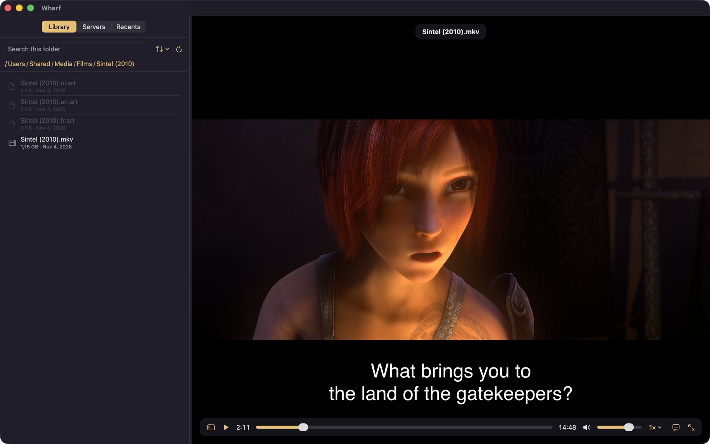

<p align="center">
  
</p>

<h1 align="center">Wharf</h1>

<p align="center">
  A native macOS video player for films on your SFTP server.<br>
  Browse a remote folder, click a video, and it plays. Nothing is downloaded first.
</p>

<p align="center">
  <a href="https://wharf.bimurto.io">Website</a> ·
  <a href="https://github.com/bimurto/wharf-player/releases/latest">Download</a> ·
  <a href="#build-from-source">Build from source</a> ·
  <a href="https://github.com/bimurto/wharf-player/issues">Report a problem</a>
</p>

<p align="center">
  <a href="LICENSE"></a>
  
  
</p>

<!-- Screenshot: add docs/images/wharf-player.png (the main window playing a video, Library sidebar open), then uncomment.
<p align="center">
  
</p>
-->

Wharf is for people who keep their films on a seedbox, NAS or VPS and want to watch them on a Mac without copying them over first. Playback, decoding and subtitle rendering are done by [mpv](https://mpv.io) (libmpv). Wharf adds the connections, the browsing and the history around it.

## Features

- **Streaming over SFTP.** A local pipelined proxy serves byte ranges to mpv, with 32 reads of 64 KiB in flight, so seeking works without downloading the file.
- **Server profiles.** Save a label, host, port, user, password or key file, optional key passphrase and default directory.
- **Test Connection.** Authenticates, lists the default directory and reports the real failure reason.
- **Library browser.** Breadcrumbs, sizes and dates, sort by name or date, search, refresh. The last folder is remembered per server.
- **Recents with resume.** Picks up where you left off, with the audio track you chose.
- **Subtitles.** Embedded tracks, external files found next to the video (SRT, VTT, ASS, SSA), or a local file you choose. Adjust sync offset, size and position.
- **Audio tracks.** Files with more than one audio track get a menu to pick one. Wharf remembers the choice per file.
- **Open by URL.** Paste an `sftp://user@host/path` address with `Cmd+O`.

## Download

Download the latest `Wharf-<version>-arm64.dmg` from [Releases](https://github.com/bimurto/wharf-player/releases/latest), open it and drag Wharf to Applications. Each release has a `.sha256` file to check the download against.

Requires a Mac with Apple silicon on macOS 26 or later.

The app is ad-hoc signed and the DMG is not notarised, so macOS shows a warning the first time you open it. Right-click the app and choose Open, or run:

```sh
xattr -dr com.apple.quarantine /Applications/Wharf.app
```

## Getting started

1. Open **Servers** (`Cmd+2`) and add a server: host, port, user name, and a password or key file. Press **Test Connection** to check it.
2. The first time you connect, Wharf shows the server's SHA256 fingerprint. Choose **Trust** if you expect that server.
3. Press **Use**. The **Library** opens the server's default folder. Click a video to play it.

You can also open a single file with `Cmd+O` and an `sftp://` address. A URL that matches a saved server uses that server's credentials.

### Keyboard shortcuts

| Key | Action |
|---|---|
| `Space` | Play / pause |
| `←` / `→` | Seek 10 s (60 s with `Shift`) |
| `↑` / `↓` | Volume (up to 130%) |
| `F` or double-click | Full screen |
| `Cmd+O` | Open URL |
| `Cmd+1` / `Cmd+2` / `Cmd+3` | Show or hide Library, Servers, Recents |
| `←` / `→` on the sidebar divider | Resize the sidebar (`Home` / `End` for narrowest and widest) |

The speed, audio track (2+ tracks only) and subtitle menus are in the control bar. Controls hide after 2.8 s without mouse movement while playing.

## Privacy and security

- Passwords and key passphrases live in the macOS Keychain, never in profile files, URLs, recents or logs. Deleting a server removes its secret from the Keychain.
- Host keys are trusted on first use. The first connection shows the SHA256 fingerprint and asks. A changed key is refused.
- Wharf keeps its own known-hosts file and never reads or writes `~/.ssh/known_hosts`. Your `~/.ssh/config` is ignored too, so behaviour is the same on every Mac.
- The streaming proxy listens on `127.0.0.1` only, and every URL carries a random token so other local processes can't read your server through it.
- Wharf makes no network connections other than to the servers you add.

## Build from source

### Requirements

- macOS 14 or later to build (`Package.swift`). The built app bundle declares macOS 26 as its minimum (`LSMinimumSystemVersion` in `scripts/build-app.sh`).
- Swift 5.9 toolchain (Xcode or Command Line Tools)
- [Homebrew](https://brew.sh) with `libssh`, plus an `ffmpeg` and `mpv` built with libssh support (next section):

```sh
brew install libssh
```

### FFmpeg and mpv with libssh

The stock Homebrew `ffmpeg` is built without `--enable-libssh`, so build `ffmpeg` and `mpv` from source with it turned on:

1. Run `brew edit ffmpeg`.
2. Add `depends_on "libssh"` to the `depends_on` lines.
3. Add `--enable-libssh` to the `args = %W[` list in `def install`.
4. Build both from source:

```sh
HOMEBREW_NO_INSTALL_FROM_API=1 brew install --build-from-source ffmpeg
HOMEBREW_NO_INSTALL_FROM_API=1 brew install --build-from-source mpv
```

`mpv` is rebuilt so it links against the new `ffmpeg`. A later `brew upgrade ffmpeg` replaces your edit with the stock formula, so repeat these steps after upgrading.

### Build and run

```sh
swift build
swift run SFTPPlayer
```

Run the tests:

```sh
swift test
```

### Package the app

```sh
scripts/build-app.sh   # build/Wharf.app
scripts/build-dmg.sh   # build/Wharf-<version>-<arch>.dmg and .sha256
```

`build-app.sh` builds a release binary, assembles the bundle, copies in libmpv and its dylibs (`bundle-libs.sh`), generates the third-party notices (`gen-notices.sh`), rewrites install names and ad-hoc signs (`relocate-libs.sh`), then checks the bundle is self-contained (`verify-bundle.sh`). The version comes from `VERSION`.

The icon is read from `ICON_SRC`, which defaults to a path on the author's machine. Set it to your own `.icns` file:

```sh
ICON_SRC=/path/to/icon.icns scripts/build-app.sh
```

## Project layout

```
Sources/
  Core/         Profiles, Keychain, SFTP browsing and proxy, host keys, recents, subtitles. No UI.
  SFTPPlayer/   SwiftUI app and the mpv wrapper and video view
  CMPV/         System-library shim for libmpv
  CLibSSH/      System-library shim for libssh
  Spike/        Phase 0 experiments (throughput, proxy)
Tests/CoreTests/  Unit tests for Core
scripts/        App bundle, DMG and library bundling
site/           The website, wharf.bimurto.io (deployed by .github/workflows/pages.yml)
docs/           Phase requirements and one file per ticket
```

Planning and status are in [`docs/`](docs/README.md), one folder per phase:

- [Phase 0: Risk spike](docs/phase-0-risk-spike/README.md) (done)
- [Phase 1: MVP feature parity](docs/phase-1-mvp/README.md) (in progress)
- [Phase 2: Packaging and release](docs/phase-2-packaging/README.md) (in progress)

## Contributing

Bug reports and pull requests are welcome.

- **Report a bug** in [Issues](https://github.com/bimurto/wharf-player/issues). Say what you did, what you expected, and what happened, with your macOS version and the server type (OpenSSH, a seedbox provider, a NAS). Never paste passwords, keys or private host names.
- **For a larger change,** open an issue first so we can agree on the approach.
- **Before a pull request,** run `swift test`, and keep commits in the existing style (`feat:`, `fix:`, `docs:` and so on).

## Acknowledgements

Wharf stands on [mpv](https://mpv.io), [FFmpeg](https://ffmpeg.org), [libssh](https://www.libssh.org) and [libass](https://github.com/libass/libass).

## Licence

Wharf is free software under the GNU General Public License v3.0 or later. See [`LICENSE`](LICENSE).

The app bundles unmodified Homebrew builds of mpv, FFmpeg and their dependencies under their own licences. See [`THIRD-PARTY-NOTICES.md`](THIRD-PARTY-NOTICES.md) and the written source offer in [`SOURCE-OFFER.md`](SOURCE-OFFER.md).
